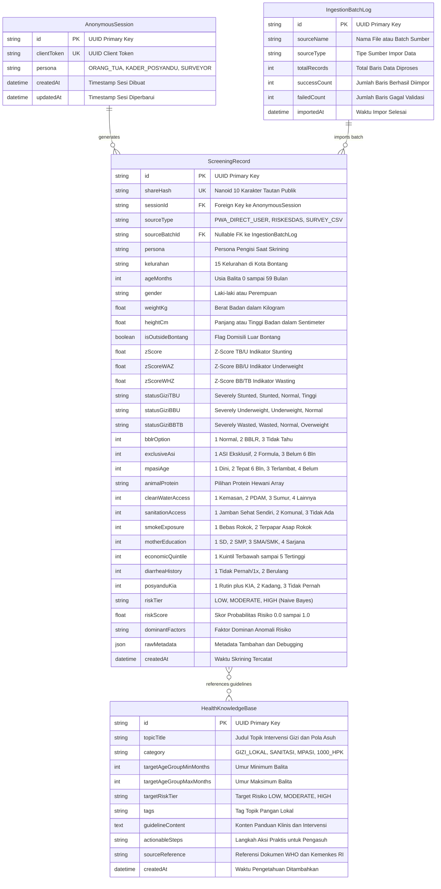
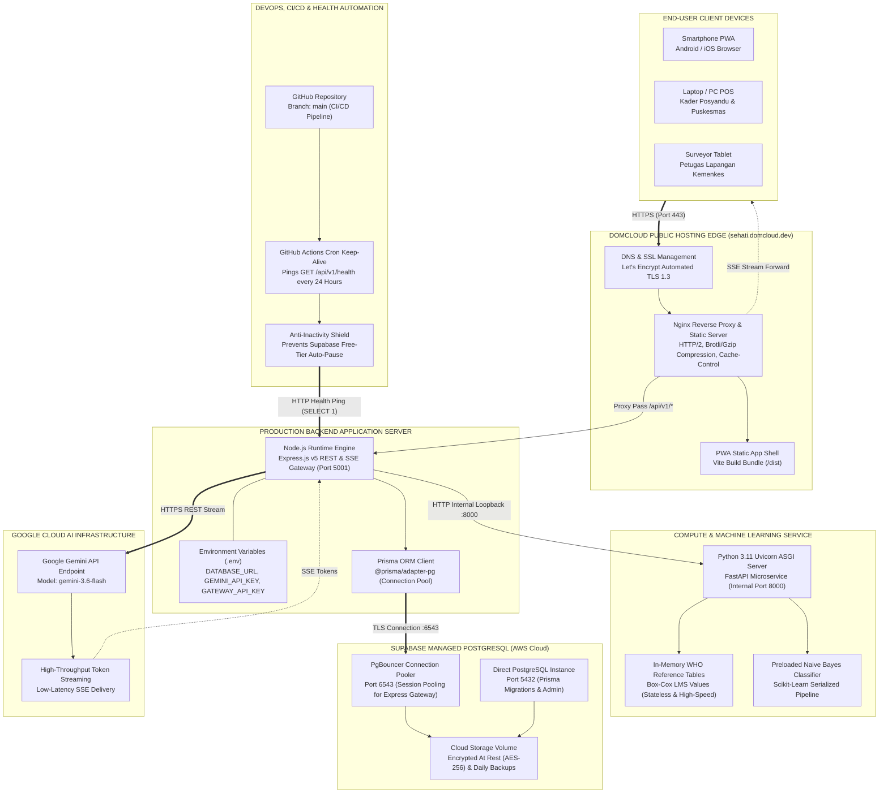

# 📐 KATALOG DIAGRAM ARSITEKTUR SISTEM SEHATI
### Sistem Edukasi Holistik dan Deteksi Stunting Terintegrasi (Kota Bontang)
**Status Dokumen**: Approved Architectural Specification (Level: System Analyst)  
**Versi**: 1.0.0-PROD  
**URL Publik Terintegrasi**: [https://sehati.domcloud.dev/](https://sehati.domcloud.dev/)  
**Target SDG**: SDG 3 (Good Health & Well-being) & SDG 2 (Zero Hunger / Target 2.2 Malnutrisi)

---

## 📑 Daftar Isi Diagram
1. [Entity Relationship Diagram (ERD)](#1-entity-relationship-diagram-erd) `[Status: Wajib]`
2. [System Architecture / High-Level Architecture Diagram](#2-system-architecture--high-level-architecture-diagram) `[Status: Sangat Direkomendasikan]`
3. [Flowchart & Activity Diagram (Alur Logika Bisnis)](#3-flowchart--activity-diagram-alur-logika-bisnis) `[Status: Wajib]`
4. [Deployment & Infrastructure Diagram](#4-deployment--infrastructure-diagram) `[Status: Nilai Tambah / Kedalaman Teknis]`
5. [Panduan Ekspor & Pemeliharaan Diagram](#5-panduan-ekspor--pemeliharaan-diagram)

---

## 1. Entity Relationship Diagram (ERD)
* **Status**: Wajib (Komponen Basis Data Utama)
* **Tujuan**: Memetakan perancangan basis data relasional di Supabase PostgreSQL secara menyeluruh, membuktikan kerapian normalisasi, relasi antar entitas, penegakan integritas data (*Primary Key*, *Foreign Key*, *Unique Constraints*), serta pengindeksan performa tinggi.
* **File Sumber**: [`erd.mmd`](erd.mmd)
* **Aset Ekspor**: [Lihat Format Vektor (SVG)](erd.svg) | [Lihat Format Gambar (PNG)](erd.png)



### Analisis Teknis Database:
1. **Pola Anonymous Session & Zero-Login Friction**:
   - Pengguna tidak diwajibkan melakukan registrasi email/password yang memperlambat adopsi di posyandu.
   - Sesi diikat menggunakan `clientToken` unik berbasis UUID v4 yang disimpan di *secure storage* browser dan ditautkan ke entitas `AnonymousSession`.
2. **Integritas Relasional & Cascade Deletion**:
   - Relasi antara `AnonymousSession` dan `ScreeningRecord` bersifat One-to-Many (`1:N`) dengan aturan `onDelete: Cascade`.
3. **Privasi & Shareable Link**:
   - Setiap hasil skrining dilengkapi `shareHash` berupa nanoid acak 10 karakter (misal `xK9_mQ2L1z`). Hal ini memungkinkan orang tua atau kader membagikan hasil analitik ke dokter/keluarga tanpa mengekspos ID internal database.
4. **Strategi Pengindeksan (B-Tree Indexes)**:
   - `@@index([sessionId])`: Mempercepat lookup riwayat skrining per sesi perangkat.
   - `@@index([shareHash])`: Memastikan waktu respons O(1) saat mengakses rute `/analytics/:shareHash`.
   - `@@index([kelurahan])`: Mengoptimalkan agregasi pemetaan epidemiologi 15 kelurahan Kota Bontang.
   - `@@index([riskTier])`: Mempercepat query filtering intervensi prioritas tinggi (HIGH risk).

---

## 2. System Architecture / High-Level Architecture Diagram
* **Status**: Sangat Direkomendasikan
* **Tujuan**: Menggambarkan arsitektur multi-tier berorientasi layanan (*service-oriented*), interkoneksi protokol komunikasi antara Client (PWA), API Gateway (Express.js), Microservice Komputasi (FastAPI), Layanan AI (Google Gemini), dan Basis Data Terkelola (Supabase PostgreSQL).
* **File Sumber**: [`system-architecture.mmd`](system-architecture.mmd)
* **Aset Ekspor**: [Lihat Format Vektor (SVG)](system-architecture.svg) | [Lihat Format Gambar (PNG)](system-architecture.png)

```mermaid
graph TB
    subgraph ClientLayer["CLIENT LAYER - Frontend PWA (React 19 + TypeScript)"]
        direction TB
        PWA["PWA Client - sehati.domcloud.dev<br/>Vite + React 19 + TailwindCSS v4"]
        SW["Service Worker<br/>vite-plugin-pwa (Cache-First Shell)"]
        IDB[("IndexedDB Storage<br/>idb-keyval (Offline Drafts & Queue)")]
        UI_Q["Multi-Step Questionnaire<br/>Framer Motion (Antropometri & Determinan)"]
        UI_Dash["Analytics Dashboard<br/>@dnd-kit (Draggable Grid Widgets)"]
        UI_Chart["Growth Curves & Gauges<br/>Chart.js + Recharts + Gauge Component"]
        UI_Chat["AI Chat Assistant Drawer<br/>@microsoft/fetch-event-source (SSE Client)"]

        PWA --> SW
        PWA --> IDB
        PWA --> UI_Q
        PWA --> UI_Dash
        UI_Dash --> UI_Chart
        UI_Dash --> UI_Chat
    end

    subgraph GatewayLayer["API GATEWAY LAYER - Node.js + Express.js"]
        direction TB
        GW["Express.js API Gateway (:5001)<br/>Helmet, CORS, Rate-Limiter, Morgan"]
        ZodVal["Schema Validator<br/>Zod (Antropometri & Determinan)"]
        SessMgr["Anonymous Session Manager<br/>UUID Client Token Handler"]
        ScreeningCtrl["Screening Controller<br/>POST /api/v1/screening/submit"]
        ChatCtrl["SSE Stream Controller<br/>POST/GET /api/v1/chat/stream"]
        IngestAdapter["Batch Ingestion Adapter<br/>POST /api/v1/ingest/upload/:sourceType"]
        HealthCtrl["Health Check Ping<br/>GET /api/v1/health"]

        GW --> ZodVal
        ZodVal --> SessMgr
        SessMgr --> ScreeningCtrl
        GW --> ChatCtrl
        GW --> IngestAdapter
        GW --> HealthCtrl
    end

    subgraph MLLayer["MACHINE LEARNING SERVICE LAYER - Python 3.11 + FastAPI"]
        direction TB
        FastAPIApp["FastAPI Microservice (:8000)<br/>Uvicorn ASGI Engine"]
        LMS_Engine["Triple-Index WHO Z-Score Engine<br/>Box-Cox LMS Method (TB/U, BB/U, BB/TB)"]
        NB_Classifier["Categorical Naive Bayes Classifier<br/>Scikit-Learn (98.4% Akurasi, 3 Tiers)"]
        Factor_Extract["Dominant Risk Factor Extractor<br/>Posterior Probability Impact Analysis"]

        FastAPIApp --> LMS_Engine
        FastAPIApp --> NB_Classifier
        NB_Classifier --> Factor_Extract
    end

    subgraph CloudAILayer["GENERATIVE AI & GROUNDING LAYER"]
        direction TB
        GeminiSDK["Google Gen AI SDK (@google/genai)<br/>gemini-3.6-flash"]
        PromptEngine["Contextual Prompt Builder<br/>Child Metrics + Knowledge Grounding"]
        SSEStreamer["Token-by-Token SSE Streamer<br/>AsyncGenerator Pipeline"]

        PromptEngine --> GeminiSDK
        GeminiSDK --> SSEStreamer
    end

    subgraph DataLayer["PERSISTENCE LAYER - Supabase Managed PostgreSQL"]
        direction TB
        PrismaClient["Prisma ORM Client v7.x<br/>@prisma/client + @prisma/adapter-pg"]
        Pooler["Connection Pooler<br/>PgBouncer Session Mode (:6543)"]
        DirectDB["Direct PostgreSQL (:5432)<br/>Schema Migrations"]
        
        T_Session["Table: AnonymousSession"]
        T_Screening["Table: ScreeningRecord"]
        T_KB["Table: HealthKnowledgeBase"]
        T_Ingest["Table: IngestionBatchLog"]

        PrismaClient --> Pooler
        Pooler --> T_Session
        Pooler --> T_Screening
        Pooler --> T_KB
        Pooler --> T_Ingest
        DirectDB --> T_Screening
    end

    subgraph ExternalSources["EXTERNAL DATA SOURCES & AUTOMATION"]
        direction TB
        Kemenkes["Kemenkes RI / SSGI<br/>Riskesdas & Survey Datasets (CSV)"]
        GHActions["GitHub Actions Cron<br/>Keep-Alive Pinger (24h Interval)"]
        DomcloudHost["Domcloud Hosting<br/>Public Production Edge (PWA)"]
    end

    %% Network & Data Flow Connections
    PWA -.->|"HTTP/HTTPS REST"| GW
    UI_Q -->|"POST /screening/submit"| GW
    UI_Chat -->|"SSE Request"| ChatCtrl
    IDB -.->|"Auto-Sync Drafts"| GW

    ScreeningCtrl -->|"HTTP POST /api/v1/predict"| FastAPIApp
    FastAPIApp -->|"Z-Scores, Tiers, Factors"| ScreeningCtrl

    ChatCtrl -->|"Direct-DB Query"| PrismaClient
    ChatCtrl -->|"Inject Rekam Medis"| PromptEngine
    SSEStreamer -->|"Token Stream (text/event-stream)"| UI_Chat

    ScreeningCtrl -->|"Create Record"| PrismaClient
    IngestAdapter -->|"Batch Insert"| PrismaClient
    IngestAdapter <--|"CSV / Riskesdas Data"| Kemenkes

    GHActions -->|"Keep-Alive Ping (GET /api/v1/health)"| HealthCtrl
    HealthCtrl -->|"SELECT 1 Ping"| PrismaClient
    DomcloudHost --- PWA
```

### Analisis Peran Arsitektural:
1. **Prinsip Separation of Concerns (SoC)**:
   - Komputasi statistik matematika murni (Box-Cox LMS) dan algoritma machine learning diisolasi dalam FastAPI Microservice berbasis Python agar performa inferensi tetap stabil di bawah 20 ms tanpa membebani event loop Node.js.
   - Node.js Express berperan sebagai orkestrator murni: memvalidasi input, mengelola session, menghubungkan antarmuka streaming SSE, dan memfasilitasi transaksi basis data.
2. **Direct-DB Fetch & Anti-Hallucination Grounding**:
   - Chatbot AI ("HATI Assistant") tidak menjawab secara spekulatif. Endpoint SSE membaca data aktual balita (antropometri, usia, Z-score, determinan) langsung dari database melalui Prisma, kemudian menyuntikkannya ke dalam *System Instruction* Google Gemini 3.6-flash bersama referensi intervensi gizi lokal (ikan bawis, telur ayam, daun kelor).
3. **Resiliensi Jaringan Berbasis PWA & IndexedDB**:
   - Frontend mengadopsi arsitektur *Mock-First* dan *Offline-First*. Apabila jaringan kader di lapangan terputus, kuesioner disimpan secara instan di IndexedDB (`idb-keyval`) dan disinkronisasikan otomatis saat jaringan online kembali.

---

## 3. Flowchart & Activity Diagram (Alur Logika Bisnis)
* **Status**: Wajib (Alur Kerja Bisnis Utama Aplikasi)
* **Tujuan**: Memetakan logika perjalanan data pengguna dari saat pertama kali mengakses aplikasi, pengisian kuesioner adaptif, percabangan offline/online, validasi backend, komputasi analitik, hingga keluaran dashboard dan konsultasi interaktif berbasis AI.
* **File Sumber**: [`flowchart-activity.mmd`](flowchart-activity.mmd)
* **Aset Ekspor**: [Lihat Format Vektor (SVG)](flowchart-activity.svg) | [Lihat Format Gambar (PNG)](flowchart-activity.png)

```mermaid
flowchart TD
    startNode([Pengguna Mengakses Aplikasi<br/>sehati.domcloud.dev]) --> checkNetwork{Periksa Koneksi Internet}

    %% Mode Offline / Online Detection
    checkNetwork -->|Offline| offlinePWA[Muat PWA Shell via Service Worker Cache]
    checkNetwork -->|Online| onlinePWA[Muat Halaman Langsung dari Edge Server]

    offlinePWA --> landingPage[Halaman Landing Page<br/>Statistik Stunting Bontang 27.4%]
    onlinePWA --> landingPage

    landingPage --> clickStart[Klik Tombol Mulai Skrining<br/>Zero-Login Friction]
    clickStart --> formStep1[Step 1: Seleksi Persona dan Wilayah<br/>Pilih Persona dan Kelurahan di Kota Bontang]

    formStep1 --> formStep2[Step 2: Antropometri Balita<br/>Jenis Kelamin, Usia 0-59 Bln, Berat kg, Tinggi cm]
    formStep2 --> formStep3[Step 3: Determinan Lingkungan dan Pola Asuh<br/>ASI, MPASI, Sanitasi, Air Bersih, Asap Rokok, Diare]

    formStep3 --> submitDecision{Apakah Perangkat Sedang Online}

    %% Jalur Offline Buffering
    submitDecision -->|Offline| saveIndexedDB[Simpan Payload ke Antrean IndexedDB<br/>idb-keyval Local Buffer]
    saveIndexedDB --> notifyOffline[Notifikasi: Data Tersimpan Lokal Secara Aman<br/>Status Pending Sync]
    notifyOffline --> waitOnline[Tunggu Event online Window Browser]
    waitOnline --> autoSync[Otomatis Trigger Sinkronisasi Antrean ke Gateway]
    autoSync --> submitPayload

    %% Jalur Online Submission
    submitDecision -->|Online| submitPayload[Kirim HTTP POST /api/v1/screening/submit<br/>Payload JSON + UUID clientToken]

    %% Gateway & Validation
    submitPayload --> valGate{Validasi Schema Zod di Backend}
    valGate -->|Invalid| errVal[Return 400 Bad Request<br/>Tampilkan Pesan Validasi Error ke User]
    errVal --> formStep2

    valGate -->|Valid| sessionHandling[Cek atau Buat AnonymousSession<br/>Lookup clientToken di Supabase]
    sessionHandling --> callML[Panggil FastAPI ML Microservice<br/>POST /api/v1/predict]

    %% ML Microservice Processing
    subgraph ML_Microservice["Eksekusi di Microservice ML (FastAPI)"]
        direction TB
        calcLMS[Komputasi Box-Cox LMS WHO 2006<br/>Hitung Z-Score TB/U, BB/U, BB/TB]
        calcNB[Inferensi Model Naive Bayes<br/>Hitung Probabilitas Posterior Risiko Stunting]
        classifyStatus[Klasifikasi Status Gizi dan Risk Tier<br/>LOW, MODERATE, HIGH plus Ekstraksi Faktor Dominan]

        calcLMS --> calcNB --> classifyStatus
    end

    callML --> ML_Microservice
    classifyStatus --> returnMLResult[Kembalikan Hasil Prediksi Lengkap ke Gateway]

    %% Persistence & Hash
    returnMLResult --> saveDB[Simpan Record ke Tabel ScreeningRecord<br/>Relasi ke AnonymousSession]
    saveDB --> genHash[Generate nanoid Unique shareHash<br/>10 Karakter Acak Unik]
    genHash --> returnClient[Respon 201 Created ke Frontend PWA<br/>Data Rekam Medis plus shareHash]

    %% Frontend Analytics Rendering
    returnClient --> renderDashboard[Tampilkan Dashboard Analitik Interaktif<br/>URL: /analytics/:shareHash]
    renderDashboard --> widgetCurves[Widget 1: Kurva Baku Pertumbuhan WHO 2006<br/>Plotting Z-Score TB/U, BB/U, BB/TB]
    renderDashboard --> widgetGauge[Widget 2: Risk Gauge Meter Kerentanan]
    renderDashboard --> widgetRadar[Widget 3: Radar Chart Faktor Pemicu Risiko]
    renderDashboard --> widgetFood[Widget 4: Rekomendasi Pangan Lokal Bontang<br/>Ikan Bawis, Bandeng, Telur, Daun Kelor]
    renderDashboard --> widgetShare[Widget 5: Salin Link Publik Hasil Skrining]

    %% AI Consultation Drawer Flow
    renderDashboard --> openChat[Pengguna Membuka Drawer Chat HATI Assistant]
    openChat --> sendChatQuery[Kirim Pertanyaan Edukasi Gizi Balita]
    sendChatQuery --> chatGateway[Request ke /api/v1/chat/stream<br/>sessionId + query + history]

    subgraph ChatGrounding["AI Direct-DB Grounding dan SSE Streaming"]
        direction TB
        fetchChildData[Ambil Rekam Medis Balita dari ScreeningRecord]
        fetchKB[Ambil Panduan Intervensi dari HealthKnowledgeBase]
        injectPrompt[Inject Data Balita ke System Instruction Gemini]
        callGemini[Panggil Google Gemini 3.6-flash Model]
        streamTokens[Alirkan Token Kata per Kata via SSE<br/>Content-Type: text/event-stream]

        fetchChildData --> injectPrompt
        fetchKB --> injectPrompt
        injectPrompt --> callGemini
        callGemini --> streamTokens
    end

    chatGateway --> ChatGrounding
    streamTokens --> displayChat[Teks Muncul Real-Time di Chat Drawer Pengguna]
    displayChat --> endNode([Selesai: Pengguna Menerima Wawasan Terarah])
```



---

## 4. Deployment & Infrastructure Diagram
* **Status**: Nilai Tambah (Kedalaman Teknis & Ekosistem Produksi)
* **Tujuan**: Menunjukkan arsitektur topologi cloud hosting publik di Domcloud, integrasi managed Supabase connection pooling, enkripsi SSL/TLS, keamanan environment variables, serta pipeline otomatisasi CI/CD untuk keandalan layanan 24/7.
* **File Sumber**: [`deployment-infrastructure.mmd`](deployment-infrastructure.mmd)
* **Aset Ekspor**: [Lihat Format Vektor (SVG)](deployment-infrastructure.svg) | [Lihat Format Gambar (PNG)](deployment-infrastructure.png)



---

## 5. Panduan Ekspor & Pemeliharaan Diagram

Untuk mengekspor ulang atau memperbarui diagram di masa mendatang ketika terjadi perubahan skema basis data atau penambahan microservice baru:

1. **Pastikan File Sumber `.mmd` telah diperbarui** pada folder `diagrams/`.
2. **Jalankan Script Otomasi**:
   ```bash
   node scripts/export-diagrams.js
   ```
3. Script akan otomatis memproses dan menimpa file `.svg` dan `.png` dengan resolusi tinggi tanpa perlu instalasi aplikasi desktop pihak ketiga.
