# 📄 Modul 01: Spesifikasi Halaman Landing Page (`/`)

Dokumen ini berisi rincian komponen, struktur UI, state, props, dan data hardcode yang dibutuhkan untuk **Landing Page (`/`)**.

---

## 1. Ikhtisar Halaman
* **Rute URL:** `/`
* **Tujuan:** Memberikan impresi awal (*high-impact first impression*), mengedukasi urgensi pencegahan stunting di Kota Bontang, dan mengarahkan pengguna untuk langsung memulai skrining tanpa hambatan login (*Zero-Login Friction*).

---

## 2. Diagram Pohon Komponen (*Component Tree*)

```mermaid
graph TD
    LandingPage["LandingPage (Root Container)"]
    LandingPage --> FloatingHeaderNavbar["FloatingHeaderNavbar"]
    FloatingHeaderNavbar --> BrandLogo["BrandLogo ('SEHATI')"]
    FloatingHeaderNavbar --> ConnectionStatusBadge["ConnectionStatusBadge (Online/Offline)"]
    FloatingHeaderNavbar --> PWAInstallButton["PWAInstallButton ('Pasang Aplikasi')"]
    FloatingHeaderNavbar --> NavScreeningCTA["NavScreeningCTA ('Mulai Skrining')"]

    LandingPage --> HeroSection["HeroSection"]
    HeroSection --> HeroBadge["HeroBadge ('Inisiatif Kesehatan Bontang')"]
    HeroSection --> HeroHeadline["HeroHeadline & Subtitle"]
    HeroSection --> HeroCTAButtons["HeroCTAButtons (Primary & Demo Result)"]
    HeroSection --> HeroStatsHighlights["HeroStatsHighlights (4 Grid Cards)"]

    LandingPage --> BontangContextSection["BontangContextSection"]
    BontangContextSection --> PrevalenceHighlightCard["PrevalenceHighlightCard (27.4% Stunting)"]
    BontangContextSection --> Urgency1000HPKCard["Urgency1000HPKCard (1.000 HPK)"]
    BontangContextSection --> DistrictSummaryList["DistrictSummaryList (Bontang Utara, Selatan, Barat)"]

    LandingPage --> FeatureHighlightsGrid["FeatureHighlightsGrid (3 Cards)"]
    FeatureHighlightsGrid --> CardWHOZScore["CardWHOZScore (Box-Cox LMS)"]
    FeatureHighlightsGrid --> CardNaiveBayes["CardNaiveBayes (Multivariate Risk)"]
    FeatureHighlightsGrid --> CardGeminiAI["CardGeminiAI (Streaming Chat Assistant)"]

    LandingPage --> PersonaPreviewSection["PersonaPreviewSection"]
    PersonaPreviewSection --> PersonaCardOrangTua["PersonaCard (Orang Tua / Wali)"]
    PersonaPreviewSection --> PersonaCardKader["PersonaCard (Kader Posyandu)"]
    PersonaPreviewSection --> PersonaCardSurveyor["PersonaCard (Surveyor / Nakes)"]

    LandingPage --> FooterSection["FooterSection"]
```



---

## 3. Rincian & Spesifikasi Komponen

### A. `FloatingHeaderNavbar`
* **Deskripsi:** Navbar melayang (*sticky floating*) dengan latar belakang *glassmorphism* (`backdrop-blur-md bg-white/90`).
* **Sub-Komponen:**
  1. `BrandLogo`: Logo SVG SEHATI + Label tagline.
  2. `ConnectionStatusBadge`: Menampilkan hijau (`Online`) atau amber (`Mode Offline`) berbasis `navigator.onLine`.
  3. `PWAInstallButton`: Tombol prompt instalasi PWA (hanya muncul jika browser mendukung event `beforeinstallprompt`).
  4. `NavScreeningCTA`: Tombol pintas `Link to="/questionnaire"` warna biru primer.
* **Props / State:**
  ```typescript
  interface FloatingHeaderNavbarProps {
    isOnline: boolean;
    canInstallPWA: boolean;
    onInstallPWA: () => void;
  }
  ```

---

### B. `HeroSection`
* **Deskripsi:** Bagian pembuka dengan tipografi modern, kartu highlight statistik, dan tombol Call-To-Action (CTA).
* **Elemen & Interaksi:**
  * Tagline: *"Deteksi Dini & Pencegahan Stunting Balita Secara Terintegrasi"*.
  * Subtitle penjelasan integrasi antropometri WHO, Naïve Bayes, dan pangan lokal.
  * CTA Utama: `Link to="/questionnaire"` bertuliskan *"Mulai Skrining Sekarang (Tanpa Login)"*.
  * CTA Sekunder: `Link to="/analytics/demo-sample"` bertuliskan *"Lihat Contoh Hasil Analisis"*.
  * **4 Kartu Highlight Statistik:**
    1. Standar Evaluasi: WHO 2006 (LMS)
    2. Akurasi Prediksi: Naïve Bayes Multi-Determinan
    3. Konsultasi AI: Gemini 2.5 Flash SSE Stream
    4. Kesiapan Sistem: 100% PWA Siap Offline

---

### C. `BontangContextSection`
* **Deskripsi:** Menyoroti konteks geografis dan urgensi stunting spesifik di Kota Bontang, Kalimantan Timur.
* **Komponen Data:**
  * Metrik Prevalensi Stunting: `27.4%` (Target nasional/kota: `14.0%` pada 2026).
  * Pesan Urgensi 1.000 Hari Pertama Kehidupan (HPK).
  * Cakupan 3 Kecamatan (Bontang Utara, Bontang Selatan, Bontang Barat) yang membawahi 15 Kelurahan.

---

### D. `FeatureHighlightsGrid`
* **Deskripsi:** Tiga kartu interaktif berdesain modern dengan efek *hover scale* menggunakan Framer Motion.
* **Kartu 1 - Deteksi Otomatis Z-Score WHO:**
  * Mengukur 3 indeks baku: TB/U (*Stunting*), BB/U (*Underweight*), dan BB/TB (*Wasting*).
  * Aksen warna: Biru (`#2563EB`).
* **Kartu 2 - Prediksi Risiko Naïve Bayes:**
  * Analisis determinan non-klinis: ASI eksklusif, sanitasi, air bersih, paparan rokok, ekonomi.
  * Aksen warna: Hijau Emerald (`#10B981`).
* **Kartu 3 - Asisten Konsultasi AI Gemini:**
  * Asisten interaktif berbasis protokol streaming Server-Sent Events (SSE) dengan rekomendasi pangan lokal (Ikan Bawis, dll).
  * Aksen warna: Ungu (`#8B5CF6`).

---

### E. `PersonaPreviewSection`
* **Deskripsi:** Kartu persona interaktif untuk memberikan panduan kepada Orang Tua, Kader Posyandu, dan Surveyor sebelum mengisi kuesioner.
* **Kartu Persona:**
  1. `ORANG_TUA`: Pengukuran mandiri di rumah, panduan MPASI lokal.
  2. `KADER_POSYANDU`: Pencatatan bulanan posyandu, rujukan cepat ke puskesmas.
  3. `SURVEYOR`: Pendataan survei lapangan terintegrasi.

---

## 4. Pemetaan Data Hardcode (`mock_data.json`)
Komponen pada Landing Page mengambil data dari objek JSON berikut:
* `mockData.appNavigation` -> Brand info, navigasi menu, PWA labels.
* `mockData.landingPage.heroSection` -> Teks hero, CTA, badge, dan 4 kartu highlight.
* `mockData.landingPage.bontangHealthContext` -> Statistik 27.4% prevalensi dan kecamatan.
* `mockData.landingPage.featureCards` -> 3 kartu fitur utama.
* `mockData.landingPage.testimonialsOrPersonaBrief` -> Ringkasan testimoni persona.
