# 📄 Modul 02: Spesifikasi Halaman Kuesioner (`/questionnaire`)

Dokumen ini berisi rincian komponen form terpandu 3-langkah (*multi-step guided form*), animasi transisi, skema validasi, penanganan offline draft di IndexedDB, dan integrasi data hardcode.

---

## 1. Ikhtisar Halaman
* **Rute URL:** `/questionnaire`
* **Tujuan:** Mengumpulkan data persona pengguna, data antropometri balita, dan determinan lingkungan hidup balita dengan antarmuka yang ramah pengguna, minim kesalahan (*error-preventive*), serta mendukung penyimpanan draft saat offline.

---

## 2. Diagram Pohon Komponen (*Component Tree*)

```mermaid
graph TD
    QuestionnairePage["QuestionnairePage (Root State Controller)"]
    QuestionnairePage --> StepProgressBar["StepProgressBar (Framer Motion Animation)"]
    
    QuestionnairePage --> StepContainer["StepContainer (Animated Slide In/Out)"]
    
    StepContainer --> Step1PersonaDomisili["Step 1: Step1PersonaDomisili"]
    Step1PersonaDomisili --> PersonaRadioGroup["PersonaRadioGroup (ORANG_TUA, KADER, SURVEYOR)"]
    Step1PersonaDomisili --> KelurahanSelectDropdown["KelurahanSelectDropdown (15 Kelurahan Bontang)"]
    
    StepContainer --> Step2Antropometri["Step 2: Step2Antropometri"]
    Step2Antropometri --> GenderSelectorCard["GenderSelectorCard (Laki-laki / Perempuan)"]
    Step2Antropometri --> AgeMonthsInputField["AgeMonthsInputField (0 - 59 Bulan)"]
    Step2Antropometri --> MeasurementPositionRadio["MeasurementPositionRadio (Terlentang / Berdiri)"]
    Step2Antropometri --> WeightInputField["WeightInputField (1.0 - 30.0 kg)"]
    Step2Antropometri --> HeightInputField["HeightInputField (30.0 - 130.0 cm)"]
    Step2Antropometri --> AntroLiveValidationBadge["AntroLiveValidationBadge (Status Range)"]
    
    StepContainer --> Step3Determinan["Step 3: Step3Determinan"]
    Step3Determinan --> DeterminanCardList["DeterminanCardList (8 Pertanyaan Parametrik)"]
    DeterminanCardList --> CardASI["Card 1: ASI Eksklusif 6 Bulan"]
    DeterminanCardList --> CardAirBersih["Card 2: Akses Air Bersih"]
    DeterminanCardList --> CardSanitasi["Card 3: Jamban Sehat & Septik"]
    DeterminanCardList --> CardAsapRokok["Card 4: Paparan Asap Rokok"]
    DeterminanCardList --> CardEkonomi["Card 5: Kuintil Ekonomi (1 - 5)"]
    DeterminanCardList --> CardPendidikanIbu["Card 6: Pendidikan Ibu (>= SMA)"]
    DeterminanCardList --> CardDiare["Card 7: Riwayat Diare Berulang"]
    DeterminanCardList --> CardBBLR["Card 8: Riwayat BBLR (< 2500g)"]
    
    QuestionnairePage --> FormActionControls["FormActionControls"]
    FormActionControls --> BtnPrevious["Tombol 'Sebelumnya'"]
    FormActionControls --> BtnSaveDraft["Tombol 'Simpan Draft (Offline)'"]
    FormActionControls --> BtnSubmitNext["Tombol 'Selanjutnya' / 'Lihat Hasil Analisis'"]
    
    QuestionnairePage --> OfflineDraftToast["OfflineDraftToast (IndexedDB Notification)"]
```



---

## 3. Rincian & Spesifikasi Langkah Form (*Steps Breakdown*)

### A. `StepProgressBar`
* Menampilkan indikator langkah: **Langkah 1 dari 3**, **Langkah 2 dari 3**, dan **Langkah 3 dari 3**.
* Animasi perpindahan garis progress (*progress bar fill*) menggunakan `framer-motion` dengan *spring easing*.

---

### B. `Step 1: Seleksi Persona & Domisili`
* **Komponen 1 - `PersonaRadioGroup`:**
  * Pilihan 3 kartu persona interaktif:
    1. `ORANG_TUA` ("Orang Tua / Wali")
    2. `KADER_POSYANDU` ("Kader Posyandu")
    3. `SURVEYOR` ("Surveyor / Nakes")
  * Visual: Seleksi dengan border biru (`border-blue-600`), latar lembut (`bg-blue-50/50`), dan ikon penanda.
* **Komponen 2 - `KelurahanSelectDropdown`:**
  * Dropdown interaktif dengan pencarian cepat (*searchable select*) memuat seluruh **15 Kelurahan Kota Bontang**:
    * **Bontang Utara:** Api-Api, Bontang Baru, Bontang Kuala, Guntung, Gunung Elai, Loktuan.
    * **Bontang Selatan:** Berbas Pantai, Berbas Tengah, Bontang Lestari, Satimpo, Tanjung Laut, Tanjung Laut Indah.
    * **Bontang Barat:** Belimbing, Gunung Telihan, Kanaan.

---

### C. `Step 2: Data Fisik & Antropometri Balita`
* **Komponen 1 - `GenderSelectorCard`:** Radio kartu Jenis Kelamin (`L` = Laki-laki, `P` = Perempuan) dilengkapi ikon visual.
* **Komponen 2 - `AgeMonthsInputField`:**
  * Input angka Usia Balita: `0` hingga `59` Bulan.
  * Teks panduan: *"Sasaran baku balita 0–59 bulan"*.
* **Komponen 3 - `MeasurementPositionRadio`:**
  * `Terlentang` (Panjang Badan / *Recumbent Length*, usia 0–23 bulan).
  * `Berdiri` (Tinggi Badan / *Standing Height*, usia 24–59 bulan).
* **Komponen 4 - `WeightInputField`:**
  * Berat Badan (kg), Rentang valid: `1.0` – `30.0` kg (Step: `0.1`).
* **Komponen 5 - `HeightInputField`:**
  * Panjang / Tinggi Badan (cm), Rentang valid: `30.0` – `130.0` cm (Step: `0.1`).
* **Komponen 6 - `AntroLiveValidationBadge`:** Menampilkan indikator hijau jika angka berada di rentang wajar biologis WHO.

---

### D. `Step 3: Determinan Lingkungan & Pola Asuh (Naïve Bayes Inputs)`
* Terdiri dari kartu pertanyaan interaktif dengan tombol seleksi biner (*Yes/No Card Selection*) atau pilihan kuintil:

| No | Nama Field | Tipe Input | Pilihan Nilai | Label Rekomendasi |
| :--- | :--- | :--- | :--- | :--- |
| 1 | `exclusiveAsi` | Boolean Radio Card | `true` / `false` | Ya, ASI Eksklusif 6 Bulan / Tidak |
| 2 | `cleanWaterAccess` | Boolean Radio Card | `true` / `false` | Ya, Sumber Terlindungi / Tidak Layak |
| 3 | `sanitationAccess` | Boolean Radio Card | `true` / `false` | Ya, Jamban Leher Angsa / Cemplung/Terbuka |
| 4 | `smokeExposure` | Boolean Radio Card | `false` / `true` | Bebas Asap Rokok / Ada Paparan Rokok |
| 5 | `economicQuintile` | Select 1–5 | `1, 2, 3, 4, 5` | Kuintil 1 (Sangat Rendah) s.d. Kuintil 5 (Mampu) |
| 6 | `motherEducation` | Boolean Radio Card | `true` / `false` | Tamat >= SMA / < SMA |
| 7 | `diarrheaHistory` | Boolean Radio Card | `false` / `true` | Tidak Ada / Ada Diare Berulang (>2x/3bln) |
| 8 | `bblrHistory` | Boolean Radio Card | `false` / `true` | Normal (>=2.500g) / BBLR (<2.500g) |

---

### E. `FormActionControls`
* **Tombol "Sebelumnya":** Muncul di Step 2 dan 3, kembali ke langkah sebelumnya tanpa mereset isian form.
* **Tombol "Simpan Draft (Offline)":** Menyimpan state form saat ini ke `IndexedDB` (`sehati_drafts`) dan memunculkan toast konfirmasi.
* **Tombol "Selanjutnya" / "Lihat Hasil Analisis":**
  * Step 1 & 2: Berlabel *"Selanjutnya"*.
  * Step 3: Berlabel *"Lihat Hasil Analisis"* dengan animasi loading saat mengirim data ke backend atau memproses mock inference.

---

## 4. Matriks Validasi & Pesan Error (*Frontend Validation Matrix*)

```typescript
export const QuestionnaireFormSchema = z.object({
  persona: z.enum(['ORANG_TUA', 'KADER_POSYANDU', 'SURVEYOR'], {
    required_error: 'Pilih peran Anda terlebih dahulu.'
  }),
  kelurahan: z.string().min(1, 'Pilih kelurahan domisili di Kota Bontang.'),
  gender: z.enum(['L', 'P'], {
    required_error: 'Pilih jenis kelamin balita.'
  }),
  ageMonths: z.number().int().min(0, 'Usia minimal 0 bulan.').max(59, 'Usia maksimal 59 bulan.'),
  measurementPosition: z.enum(['Terlentang', 'Berdiri']),
  weightKg: z.number().min(1.0, 'Berat minimal 1.0 kg.').max(30.0, 'Berat maksimal 30.0 kg.'),
  heightCm: z.number().min(30.0, 'Tinggi minimal 30.0 cm.').max(130.0, 'Tinggi maksimal 130.0 cm.'),
  exclusiveAsi: z.boolean(),
  cleanWaterAccess: z.boolean(),
  sanitationAccess: z.boolean(),
  smokeExposure: z.boolean(),
  economicQuintile: z.number().int().min(1).max(5),
  motherEducation: z.boolean(),
  diarrheaHistory: z.boolean(),
  bblrHistory: z.boolean()
});
```

---

## 5. Pemetaan Data Hardcode (`mock_data.json`)
* `mockData.questionnaire.steps` -> Konfigurasi progress bar & judul langkah.
* `mockData.questionnaire.step1PersonaAndLocation` -> Daftar opsi persona dan 15 Kelurahan Bontang.
* `mockData.questionnaire.step2Anthropometrics` -> Validasi antropometri, opsi posisi ukur, dan opsi gender.
* `mockData.questionnaire.step3Determinants` -> Rangkaian 8 pertanyaan determinan Naïve Bayes.
* `mockData.questionnaire.defaultInitialFormState` -> Initial form state saat kuesioner pertama kali dimuat.
