# 📄 Modul 03: Spesifikasi Halaman Analitik & Konsultasi (`/analytics`)

Dokumen ini berisi rincian arsitektur grid widget interaktif (*drag-and-drop*), 6 widget visualisasi data, integrasi kurva Z-score WHO 2006, tabel pangan lokal Bontang, dan drawer chatbot AI berbasis Server-Sent Events (SSE).

---

## 1. Ikhtisar Halaman
* **Rute URL:** `/analytics` (Hasil skrining sesi aktif) & `/analytics/:shareHash` (Tautan rujukan publik)
* **Tujuan:** Menyajikan diagnosis status gizi antropometri WHO, visualisasi derajat kerentanan risiko Naïve Bayes, intervensi menu lokal, serta sarana konsultasi AI Gemini secara real-time.

---

## 2. Diagram Pohon Komponen (*Component Tree*)

```mermaid
graph TD
    AnalyticsPage["AnalyticsPage (Root Layout)"]
    AnalyticsPage --> PatientSummaryHeader["PatientSummaryHeader (Nama/Usia/Lokasi/Status Badge)"]
    
    AnalyticsPage --> WidgetDndGridContainer["WidgetDndGridContainer (@dnd-kit/core Drag & Drop)"]
    
    WidgetDndGridContainer --> Widget1GrowthChart["Widget 1: WidgetGrowthChartWHO"]
    Widget1GrowthChart --> CurveIndexSelector["CurveIndexSelector (TB/U, BB/U, BB/TB)"]
    Widget1GrowthChart --> RechartsLinePlot["RechartsLinePlot (Kurva SD -3 s.d. +3 & Plot Balita)"]
    Widget1GrowthChart --> StatusInterpretationPill["StatusInterpretationPill ('Stunted' / 'Normal')"]
    
    WidgetDndGridContainer --> Widget2RiskGauge["Widget 2: WidgetRiskGaugeMeter"]
    Widget2RiskGauge --> ReactGaugeComponent["ReactGaugeComponent (0.0 - 1.0)"]
    Widget2RiskGauge --> RiskTierBadge["RiskTierBadge (LOW, MODERATE, HIGH)"]
    Widget2RiskGauge --> DominantFactorBadges["DominantFactorBadges (Faktor Pemicu Utama)"]
    
    WidgetDndGridContainer --> Widget3DeterminantRadar["Widget 3: WidgetDeterminantRadar"]
    Widget3DeterminantRadar --> RechartsRadarChart["RechartsRadarChart (8 Dimensi Lingkungan)"]
    Widget3DeterminantRadar --> BenchmarkComparisonLegend["BenchmarkComparisonLegend (Profil Balita vs Baku)"]
    
    WidgetDndGridContainer --> Widget4NutritionTable["Widget 4: WidgetActionableNutritionTable"]
    Widget4NutritionTable --> NutritionFilterTabs["NutritionFilterTabs (Pesisir Bontang / Protein Hewani)"]
    Widget4NutritionTable --> LocalFoodItemCardList["LocalFoodItemCardList (Ikan Bawis, Kakap, Daun Kelor)"]
    Widget4NutritionTable --> FoodDetailModal["FoodDetailModal (Resep & Takaran Saji MPASI)"]
    
    WidgetDndGridContainer --> Widget5ShareLink["Widget 5: WidgetShareableLinkBox"]
    Widget5ShareLink --> CopyLinkButton["CopyLinkButton (Clipboard Action)"]
    Widget5ShareLink --> QRCodeDisplay["QRCodeDisplay (Scan Cepat Rujukan)"]
    Widget5ShareLink --> ExportPdfButton["ExportPdfButton (Cetak Ringkasan)"]
    
    AnalyticsPage --> Widget6FloatingChat["Widget 6: FloatingAiChatDrawer (Floating Action Button & Drawer)"]
    Widget6FloatingChat --> ChatHeader["ChatHeader (Asisten SEHATI - Gemini 2.5 Flash)"]
    Widget6FloatingChat --> QuickPromptChips["QuickPromptChips (Pertanyaan Cepat Menu & Sanitasi)"]
    Widget6FloatingChat --> ChatMessageList["ChatMessageList (Streaming Markdown Renderer)"]
    Widget6FloatingChat --> ChatInputForm["ChatInputForm (SSE Connection Trigger)"]
```



---

## 3. Rincian & Spesifikasi 6 Widget Utama

### A. `Widget 1: Growth Chart WHO (Standar Deviasi LMS)`
* **Library:** `recharts` atau `chart.js`.
* **Deskripsi:** Memplot titik data balita (usia vs panjang/tinggi) di atas kurva baku standar deviasi WHO 2006.
* **Kurva Baku yang Dirender:**
  * Garis Merah Putus-putus: `-3 SD` (*Severely Stunted*)
  * Garis Amber Putus-putus: `-2 SD` (*Stunted / Garis Batas Rujukan*)
  * Garis Hijau Tebal: `0 SD` (*Median Standar WHO*)
  * Garis Hijau Putus-putus: `+2 SD` (*Batas Atas Normal*)
  * Garis Biru Putus-putus: `+3 SD` (*Tinggi*)
* **Titik Koordinat Pasien:** Lingkaran menonjol (*Pulsing Scatter Marker*) pada posisi `(usia, tinggi)`.
* **Tab Switcher:** Pengguna dapat berpindah melihat grafik **TB/U** (Stunting), **BB/U** (Underweight), atau **BB/TB** (Wasting).

---

### B. `Widget 2: Risk Gauge Meter (Naïve Bayes Classifier)`
* **Library:** `react-gauge-component`.
* **Deskripsi:** Menampilkan visualisasi speedometer jarum derajat kerentanan stunting (0.00 – 1.00).
* **Zona Nilai & Warna:**
  * `0.00 – 0.35` : **LOW** (Hijau Emerald `#10B981`) -> Aman
  * `0.35 – 0.70` : **MODERATE** (Amber `#F59E0B`) -> Waspada (Perlu Intervensi)
  * `0.70 – 1.00` : **HIGH** (Merah `#EF4444`) -> Bahaya (Rujukan Puskesmas)
* **Tag Faktor Pemicu Dominan:** Menampilkan 2 chip faktor yang paling menurunkan skor posterior (contoh: `"AKSES_SANITASI_BURUK"`, `"PAPARAN_ASAP_ROKOK"`).

---

### C. `Widget 3: Determinant Radar / Spider Chart`
* **Library:** `recharts` (`<RadarChart />`).
* **Deskripsi:** Memvisualisasikan 8 dimensi penentu kesehatan lingkungan balita secara poligon:
  1. Pemberian ASI Eksklusif
  2. Akses Air Bersih
  3. Akses Jamban Sehat
  4. Bebas Asap Rokok
  5. Kuintil Ekonomi
  6. Pendidikan Ibu
  7. Bebas Diare Berulang
  8. Berat Lahir Normal (Non-BBLR)

---

### D. `Widget 4: Actionable Local Nutrition Table (Pangan Lokal Bontang)`
* **Deskripsi:** Tabel dan kartu interaktif makanan tambahan berbasis komoditas khas pesisir Kota Bontang untuk mengejar pertumbuhan anak.
* **Daftar Komoditas Unggulan:**
  1. **Ikan Bawis Segar Bontang:** Tinggi kalsium tulang lunak dan asam amino esensial.
  2. **Ikan Kembung & Kakap Merah:** Sumber asam lemak Omega-3 DHA untuk kognitif otak.
  3. **Telur & Hati Ayam:** Padat zat besi heme pencegah anemia mikronutrien.
  4. **Olahan Rumput Laut & Daun Kelor:** Serat mineral mikro penyokong imunitas.
* **Fitur:** Filter kelompok usia (6–11 bln, 12–23 bln, 24–59 bln) dan tombol *"Lihat Cara Masak/Resep"*.

---

### E. `Widget 5: Shareable Link Box & QR Code`
* **Deskripsi:** Modul pembagian hasil diagnosis tanpa harus login.
* **Elemen:**
  * Box URL publik: `https://sehati.bontangkota.go.id/analytics/:shareHash`
  * Tombol *"Salin Tautan Rujukan"* dengan feedback animasi *check icon*.
  * Gambar QR Code siap scan untuk kader posyandu / dokter puskesmas.
  * Tombol *"Unduh Ringkasan PDF"*.

---

### F. `Widget 6: Floating AI Chatbot Drawer (Gemini 2.5 Flash)`
* **Library:** `@microsoft/fetch-event-source`.
* **Deskripsi:** Drawer mengambang (*drawer bottom/right*) yang dapat dibuka kapan saja untuk berdiskusi dengan AI.
* **Mekanisme Data:**
  1. Saat dibuka, drawer membaca data balita (usia, Z-score, kelurahan, faktor pemicu).
  2. Menyediakan 4 *Quick-Prompt Chips* (misal: *"Resep Ikan Bawis 18 bulan"*, *"Cara isolasi asap rokok di rumah"*).
  3. Input pesan mengirim query ke endpoint SSE backend `GET /api/v1/chat/stream?sessionId=...&query=...`.
  4. Menampilkan teks balasan kata demi kata (*word-by-word streaming token*) dengan formatting Markdown tebal, miring, dan list bullet.

---

## 4. Grid Drag-and-Drop Layout (@dnd-kit)

Pengguna dapat menyusun tata letak 6 widget sesuai preferensi (misalnya memprioritaskan kurva pertumbuhan di atas atau tabel makanan):
```typescript
interface DashboardWidgetOrder {
  id: string; // 'growth-chart' | 'risk-gauge' | 'radar' | 'nutrition' | 'share-link' | 'ai-chat'
  title: string;
  colSpan: 'col-span-1' | 'col-span-2' | 'col-span-3';
}
```

---

## 5. Pemetaan Data Hardcode (`mock_data.json`)
* `mockData.analyticsDashboard.sampleScreeningProfiles` -> 3 sampel profil lengkap balita (*Stunted*, *Severe*, *Normal*).
* `mockData.analyticsDashboard.widgets.widget1_growthChart` -> Dataset kurva WHO 2006 TB/U laki-laki dan posisi plotting.
* `mockData.analyticsDashboard.widgets.widget2_riskGauge` -> Konfigurasi range gauge meter dan tier.
* `mockData.analyticsDashboard.widgets.widget3_determinantRadar` -> 8 data nilai radar balita vs benchmark.
* `mockData.analyticsDashboard.widgets.widget4_localNutritionTable` -> 4 menu unggulan pangan lokal Kota Bontang.
* `mockData.analyticsDashboard.widgets.widget5_shareableLink` -> Tautan shareHash dan URL rujukan.
* `mockData.analyticsDashboard.widgets.widget6_floatingAiChatbot` -> Quick prompts dan simulasi pesan streaming Gemini.
