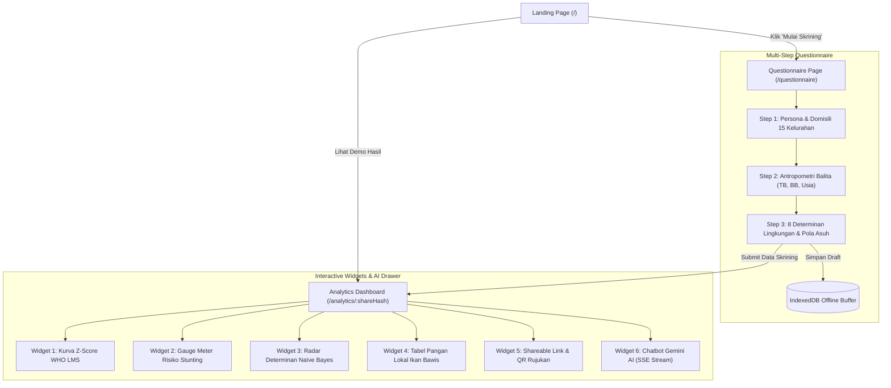

# 📑 Dokumentasi Komponen & Halaman Frontend (SEHATI)

Dokumen ini berisi peta navigasi dan referensi breakdown fungsional per halaman (*page*) dan komponen (*component*) untuk pembangunan antarmuka klien PWA **SEHATI (Sistem Edukasi Holistik dan Deteksi Stunting Terintegrasi)** mengacu pada [Frontend Client FDD.md](file:///c:/Users/ADVAN/OneDrive/Dokumen/SEHATI/frontend/Frontend%20Client%20FDD.md).

---

## 🗂️ Daftar Dokumen Spesifikasi

| No | Dokumen Spesifikasi | Halaman / Modul | Deskripsi Singkat |
| :--- | :--- | :--- | :--- |
| **00** | [00_OVERVIEW_AND_ARCHITECTURE.md](file:///c:/Users/ADVAN/OneDrive/Dokumen/SEHATI/frontend/docs/00_OVERVIEW_AND_ARCHITECTURE.md) | **Arsitektur & Standar** | Struktur folder, arsitektur state, teknologi, dan token desain. |
| **01** | [01_PAGE_LANDING.md](file:///c:/Users/ADVAN/OneDrive/Dokumen/SEHATI/frontend/docs/01_PAGE_LANDING.md) | **Landing Page (`/`)** | Hero, konteks kesehatan Kota Bontang, grid fitur, & persona selector. |
| **02** | [02_PAGE_QUESTIONNAIRE.md](file:///c:/Users/ADVAN/OneDrive/Dokumen/SEHATI/frontend/docs/02_PAGE_QUESTIONNAIRE.md) | **Questionnaire Page (`/questionnaire`)** | Form 3-step terpandu, validasi antropometri, determinan Naïve Bayes, & draft IndexedDB. |
| **03** | [03_PAGE_ANALYTICS.md](file:///c:/Users/ADVAN/OneDrive/Dokumen/SEHATI/frontend/docs/03_PAGE_ANALYTICS.md) | **Analytics Dashboard (`/analytics`, `/analytics/:shareHash`)** | 6 Widget interaktif grid drag-and-drop, kurva WHO, gauge risk, pangan lokal, & AI SSE stream. |
| **04** | [04_SHARED_COMPONENTS.md](file:///c:/Users/ADVAN/OneDrive/Dokumen/SEHATI/frontend/docs/04_SHARED_COMPONENTS.md) | **Shared UI & Utility** | Komponen reusable, floating navbar, PWA installer, drawer, modal, & offline hooks. |

---

## 🧭 Diagram Alur Navigasi Antar Halaman

---

## 📦 Sumber Data Hardcode (*Mock Data*)
Seluruh kebutuhan mock data untuk seluruh halaman di atas telah didefinisikan secara komprehensif pada file:
👉 [`frontend/mock_data.json`](file:///c:/Users/ADVAN/OneDrive/Dokumen/SEHATI/frontend/mock_data.json)
